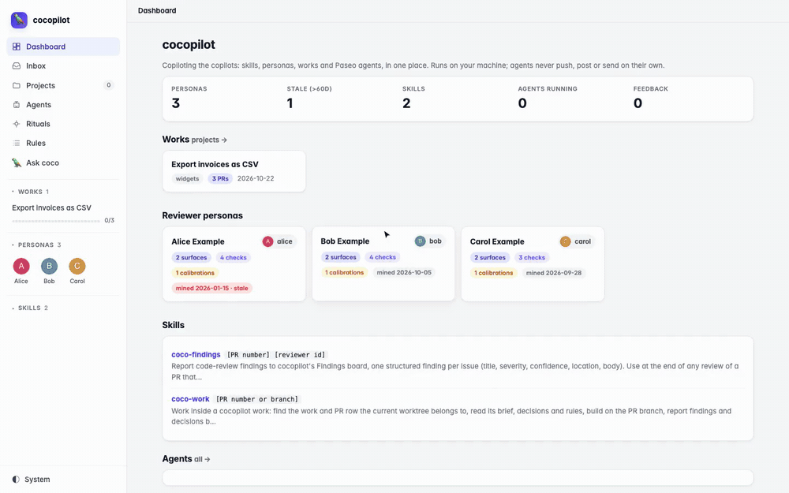
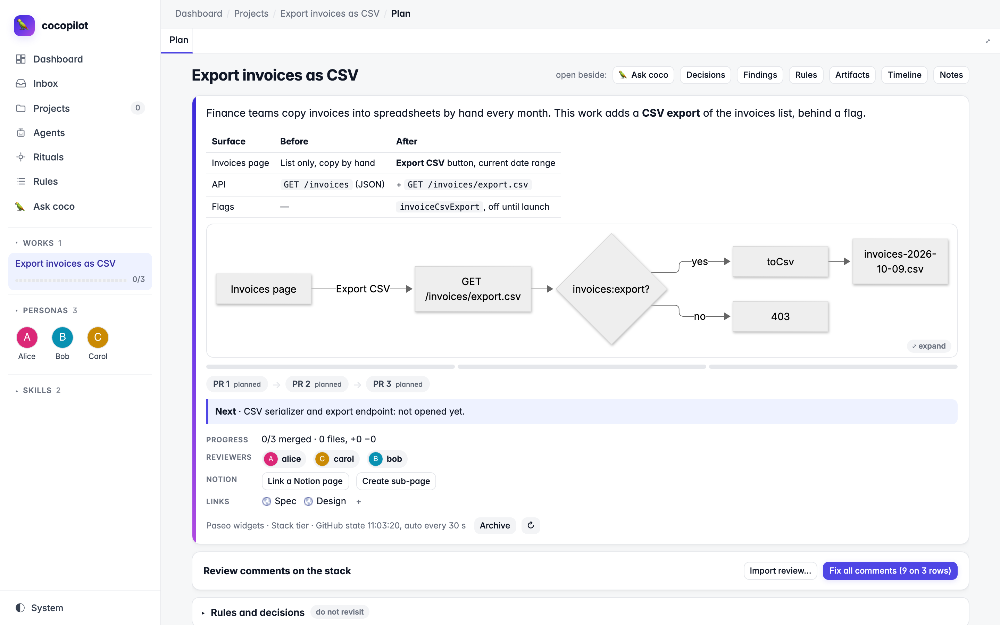
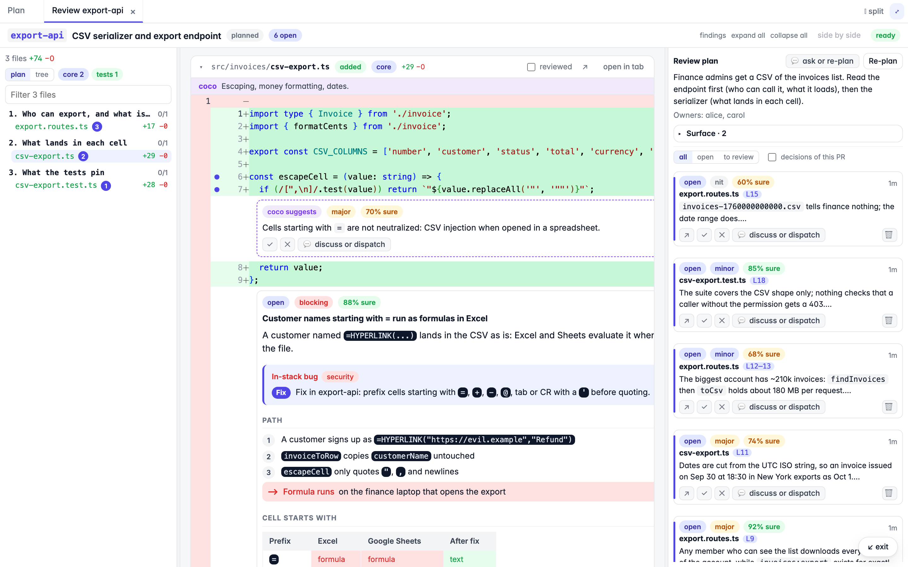
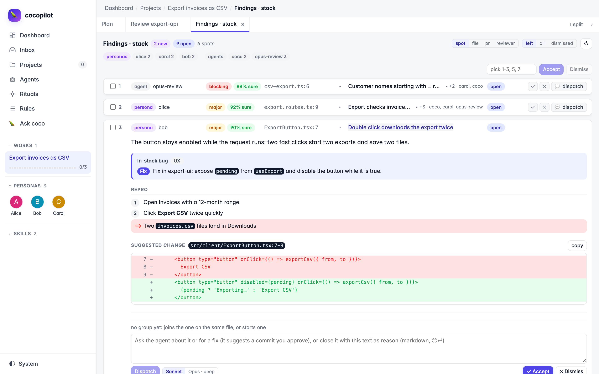
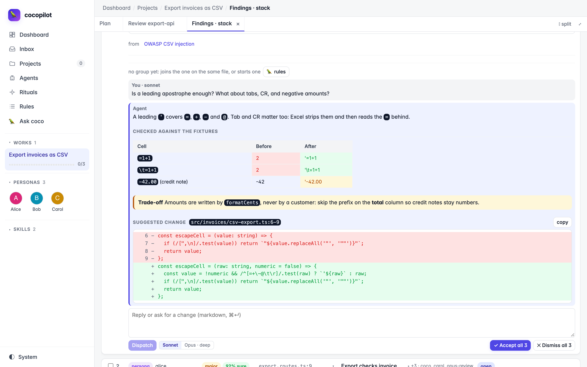

# cocopilot

A local workbench to ship large features and PR stacks with Claude Code
agents, run through [Paseo](https://paseo.sh). You plan the stack, agents
build each PR in its own worktree, and cocopilot keeps what the agents
forget: the plan, the decisions, the review comments, the findings, and
what is left before each PR can merge.

## Get started

Needs Node 20+, `git`, the [GitHub CLI](https://cli.github.com) logged in,
and [Paseo](https://paseo.sh) with Claude Code. Paste this in Claude Code:

```text
Set up cocopilot for me: follow https://raw.githubusercontent.com/ParriauxMaxime/coco/main/docs/setup.md
```

The agent checks the prerequisites, installs the skills and the Paseo
plugins, writes your config, asking only which repository you work in, and
starts the server. Paste the same line to update: it finds your install,
pulls, refreshes the skills and the plugin, and keeps your config, data and
edited skills. The [setup guide](docs/setup.md) lists every step.

Or by hand, with `COCO_REPO` set to the repository you work in:

```bash
git clone https://github.com/ParriauxMaxime/coco.git ~/cocopilot && cd ~/cocopilot
npm ci
mkdir -p ~/.claude/skills && cp -R skills/* ~/.claude/skills/
(cd paseo-plugin && npm ci) && paseo plugin install "$PWD/paseo-plugin"
(cd dev-servers && npm ci) && paseo plugin install "$PWD/dev-servers"
COCO_REPO=~/code/your-repo npm start
```

Open <http://127.0.0.1:8777>. Until everything is set, the Dashboard shows
a checklist: each missing step with its command, and a button that starts
an agent to finish the setup. To go further, see [Configure](#configure).



*A demo stack: plan and a decision, code review, findings board, checklist
gates. Full speed with better quality: [mp4](docs/media/overview.mp4) ·
[webm](docs/media/overview.webm).*

## What it does

- **Stack plan.** One page per work (a feature shipped as one PR or a
  stack): title, before/after table, PRs in merge order with their state,
  CI and reviewers, the next action, decision cards you answer with a click.
- **Code review.** An editor-like review per PR: changed files in a
  suggested reading order, Monaco diffs, go to definition and find
  references on the PR head (TypeScript language service), local comments
  anchored to lines that follow the code as the head moves.
- **Findings board.** Every remark on a PR in one list: persona reviews,
  agent reviews, your comments, GitHub reviewers, bots and failed CI.
  Grouped by spot, sorted worst first; accept, dismiss with a reason, or
  dispatch to an agent. "Fix accepted" sends every accepted finding, with
  your notes and thread outcomes, to one agent that fixes the stack.
- **Agent threads.** Discuss a comment, a finding or a decision with a small
  scoped agent. It answers inline and suggests a commit; you approve, and
  cocopilot cherry-picks it onto the PR branch.
- **Checklist gates.** Each PR carries its gates, from self review to
  merged: skills to start in the PR agent, commands to copy, ticks derived
  from GitHub and git.
- **Stack keeper.** When a parent PR merges, a dry run shows the exact
  rebases for every child; apply them locally in one click.
- **Briefs and handoffs.** Render a full task brief for a PR agent from the
  work, start the agent, or hand the PR over to a fresh one.
- **Dev servers.** A second Paseo plugin runs one app dev server per
  worktree on a stable port, shared down a stack and handed to agents
  through MCP tools; the Plan shows each row's server with start, open,
  login, logs, pin and stop.
- **Team pack.** Export personas, skills, the team config and the
  feature-flag provider as a zip for teammates; importing previews every
  file, backs up what it overwrites and keeps your personal keys.

Nothing in cocopilot pushes, posts or sends. Agents commit locally; you
push.

| | |
| --- | --- |
|  |  |
|  |  |

## Configure

Copy `coco.config.example.json` to `coco.config.json` for your name, gates,
personas and models; every key is in
[docs/configuration.md](docs/configuration.md). Drop reviewer personas in
`data/personas/` in the format of
[docs/examples/personas/alice.md](docs/examples/personas/alice.md).
Optional: the claude.ai Notion and Slack connectors in Claude Code enable the
Inbox (turn a Notion page or Slack thread into a work) and the Notion sync.

## Security

cocopilot has no authentication. It reads your repository, runs `git` and
`gh` with your credentials, and starts agents in auto mode. It binds
`127.0.0.1` by default: keep it that way, and never expose it on a network
you do not fully trust. To use it from another device, tunnel the port
(SSH, Tailscale) rather than binding `0.0.0.0`.

## Development

```bash
npm run serve   # API server on 127.0.0.1:8777
npm run dev     # Vite on 127.0.0.1:8778, proxies /api
node --test server/*.test.mjs
(cd dev-servers && npm test)
```

## Documentation

- [docs/guide.md](docs/guide.md): every surface, what it reads and writes,
  and the HTTP routes agents call.
- [docs/configuration.md](docs/configuration.md): every config key.
- [paseo-plugin/OVERVIEW.md](paseo-plugin/OVERVIEW.md): the Paseo plugin.
- [dev-servers/OVERVIEW.md](dev-servers/OVERVIEW.md): the dev-servers
  Paseo plugin.

## License

[MIT](LICENSE)
